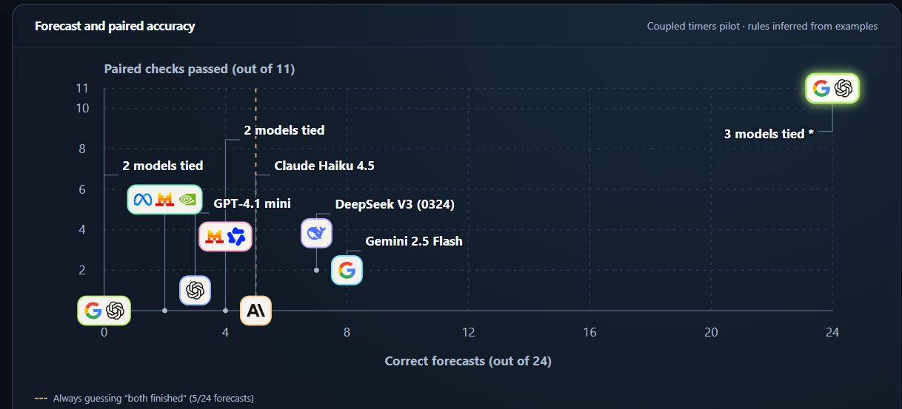

# Turnstile

**Can an AI learn how an unfamiliar system works and predict what happens next?**

Turnstile gives a model three examples of a system in action. Then it shows the model a fresh sequence of events and asks what will happen. The model submits its predictions before it sees the outcomes, and a simulator checks them.

Imagine two timers. When one finishes, it can start the other timer or cancel it. A model has to work out which rule applies from the examples, then use that rule when the timers are started in a different order.

## How the models did

**14 models** completed the original pilot. Three got all 24 forecasts right, so we reran those models on a harder task where timers can expire, send delayed signals to each other, and start again.

| Model | Original pilot | Harder follow-up |
| --- | ---: | ---: |
| GPT-6.1 Terra | 24/24 | 24/24 |
| Gemini 3.8 Flash | 24/24 | 19/24 |
| GPT-6 Luna | 24/24 | 17/24 |

The chart also shows **paired checks**. When the same events lead to different outcomes under two hidden rules, the model earns credit for getting both outcomes right. Each pilot covers four cases. [Full results and test conditions](BENCHMARK.md#evidence-and-limits)

## Try it locally

Run `npm start` with Node.js 22 or later, then open the [Turnstile overview](http://127.0.0.1:4173/). Select a point on the chart for exact scores, switch to **Harder follow-up** to compare the three reruns, or open the **Workbench** to run an offline example.

[Benchmark and CLI guide](BENCHMARK.md) · [Connecting a model](BENCHMARK.md#shared-model-interface) · [Research direction](PROJECT_DIRECTION.md)
